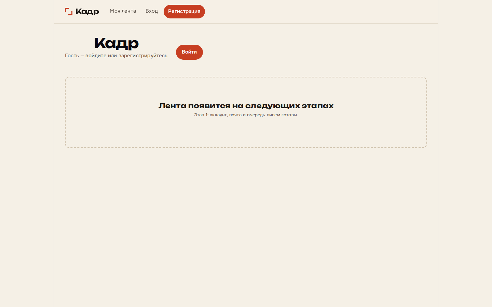
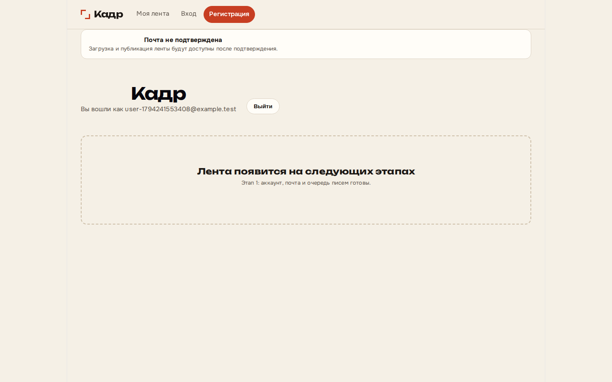
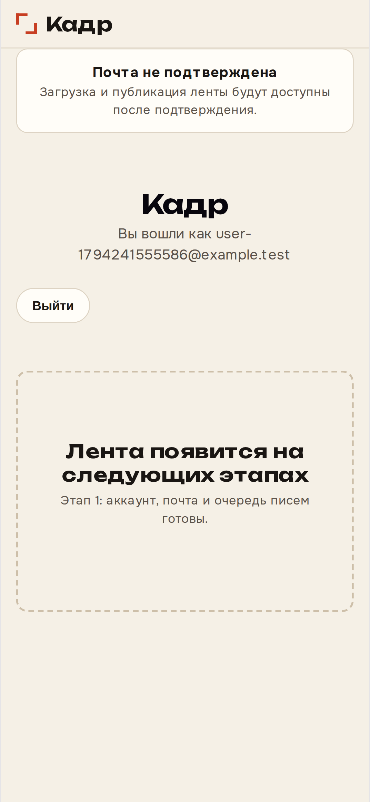

# Stage 1 report — accounts, queue, email

## Scope delivered

Per spec §5–6, §9 and Stage 0 deferrals:

- **Schema** (`000002_auth`): `users`, `email_tokens`, `sessions`, `feeds`, `outbox` (jobs table from baseline).
- **Auth API**: register, verify, verify/resend, login, logout, `GET /api/me` (quota counters stubbed at 0).
- **Decimal units** (`internal/units`): 5 GB = 5×10⁹ bytes; 50 MB photo cap constant for later stages.
- **Job queue**: `FOR UPDATE SKIP LOCKED`, lease, retries/backoff, dead letter; worker processes `send_email`.
- **Transactional outbox** + SMTP to **Mailpit** (dev profile).
- **Compose `migrate` one-shot** — api/worker no longer run migrations (`cmd/kadr migrate` only).
- **React** auth shell: register, login, email-sent, verify, home with unverified banner.

**Not in stage 1:** tus uploads, timeline, media pipeline, admin UI, password reset UI.

## Screenshots (Playwright, axe clean)

| Viewport | Home / guest | Auth flow (logged in) |
|----------|----------------|------------------------|
| Desktop 1440 |  |  |
| Mobile 390 |  |  |

## Stage 9 notes (no implementation)

- **`innodb_buffer_pool_size`** on 2 GB VPS — decide in stage 9.
- **TLS** edge (Caddy vs nginx + certs) — decide in stage 9.

## HDR / stage 4 (Den 2026-11-09)

HDR **photos and video** are tone-mapped to SDR in v1. Stage 4 estimate **+3 days** on top of baseline pipeline work (unchanged from Stage 0 note).

## Decisions made

| Topic | Decision |
|-------|----------|
| Stage 1 scope | Identity + email + queue (not upload/feed) |
| Migrations | Dedicated Compose **`migrate`** service; required schema version **2** for readiness |
| SMTP (dev) | Mailpit; publish **1025** for SMTP when bridge gateway fallback is needed |
| SMTP (prod) | Provider + domain before release (per Den) |
| Decimal units | 1 GB = 10⁹ bytes in code constants |
| Handle | Slug from email local-part; random suffix on collision |
| Argon2id | **19 MiB** memory cost so `api` fits **128M** Compose limit (was 64 MiB → OOM on register) |
| Session cookie | HttpOnly; `Secure` off in dev (`KADR_COOKIE_SECURE=1` in prod) |
| Accent color | Slightly darker `#c73e22` for WCAG AA contrast on primary buttons |
| CI networking | `ci-integration.sh` gateway fallback for MySQL DSN **and** `KADR_SMTP_HOST` when service DNS fails |
| Playwright | `workers: 1`; auth flow polls Mailpit REST API |

## Known limitations

- Password reset API not exposed (table supports `reset`).
- Login brute-force / resend limits partially implemented (DB counters only).
- `cleanup_unverified` job not scheduled.
- Container→container TCP can fail on some hosts; integration script uses bridge gateway (Stage 0 carry-over).
- nginx `proxy` → `api` may be unhealthy on same broken networks; CI starts Vite **preview** with `/api` proxy when `/health` on :8088 fails.
- `GET /api/me` quota fields are placeholders until upload stage.

## Tests

| Suite | Count (this stage) |
|-------|-------------------|
| Go `go test ./... -race` | **8** test functions across 6 packages |
| Vitest | **1** |
| Playwright + axe | **4** (2 specs × desktop + mobile) |

Local run (after `./scripts/ci-integration.sh` with `KADR_KEEP_UP=1`):

```bash
go test ./... -race -count=1
cd web && npm run test && PLAYWRIGHT_BASE_URL=http://127.0.0.1:8088 MAILPIT_URL=http://127.0.0.1:8025 npm run test:e2e
```

## CI

Workflow: `.github/workflows/ci.yml` (push `grok_bot` / PR to `develop`).

**CI run link:** https://github.com/dsefremov/kadr/actions/runs/42654946904 (PR #2, all jobs green)

## Open questions

1. Production `KADR_PUBLIC_URL` and verify-link format in outbound email?
2. Enforce login rate limits in middleware vs worker-only (spec §7)?
3. Admin bootstrap user creation workflow?
4. Password-reset UI: next stage or stage-1b?
5. Revisit argon2 cost if api memory limit is raised on VPS?
